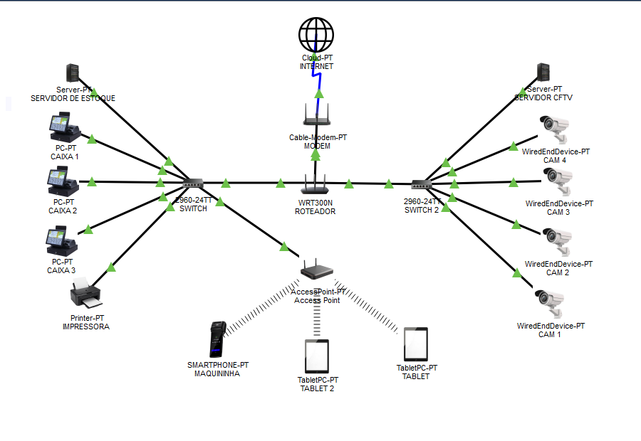

# Projeto de Infraestrutura de Rede — Ana Fashion

Projeto acadêmico desenvolvido no Cisco Packet Tracer para planejar uma rede segura e integrada para a loja Ana Fashion.

## Objetivo

Conectar os caixas, tablets, impressora, maquininha de cartão, servidor de estoque e câmeras IP, garantindo a comunicação entre os dispositivos.

## Topologia da rede

Abaixo está a topologia desenvolvida no Cisco Packet Tracer.

## Tecnologias e conceitos utilizados

- Cisco Packet Tracer
- Redes de computadores
- Endereçamento IPv4
- DHCP
- Redes cabeadas e Wi-Fi
- Testes de conectividade com ping

## Arquivo editável

O arquivo `.pkt` do projeto pode ser aberto no Cisco Packet Tracer para visualizar e modificar a topologia.
